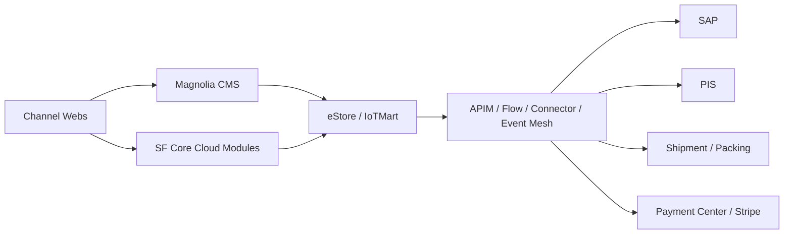

# System Landscape

## 目的
- 本檔用於跨系統問題定位與責任邊界判斷
- 不取代市場架構分流
- 當題目涉及SAP/PIS/APIM/Event Mesh/Payment/Shipment/On-Premise整合時優先參考

## 系統骨架

## 系統分層
### Channel / Frontend
- IoTMart International Web
- IoTMart North America Web
- IoTMart Euro Web

### Experience / Presentation
- Magnolia CMS(Headless)
  - UI Presentation Layer
  - Content and commerce integration layer
  - Execution point for custom business logic
  - Headless frontend orchestration layer
  - Experience management hub

### Commerce / Core
- SF core cloud modules
  - Account
  - Contact
  - Order
  - Case
  - Opportunity
- eStore / IoTMart
  - Buyer Groups
  - Entitlement Policy
  - Store
  - Pricebook
  - Category
  - Catalog
  - Product

### Integration
- APIM
- Flow
- Connector
- Event Mesh
- On-Premise

### External systems
- SAP
  - Account info
  - SO(Shipping order)
  - DN(Delivery Note)
  - Inventory
- PIS
  - Product information
  - Datasheet
  - Documents
  - Pictures
  - 2D / 3D models
- FexEx / DHL
- 3D Bin(Packing)
- Stripe / Payment Center

## 資料責任邊界
- Magnolia:
  - 前台呈現
  - 內容管理
  - 前端整合與編排
- SFCC / eStore:
  - Product
  - Catalog
  - Category
  - Pricebook
  - Buyer Groups
  - Store
- SF core cloud modules:
  - B2B core data
  - CRM related data
- SAP:
  - Account info
  - Shipping order
  - Delivery note
  - Inventory
- PIS:
  - Product documents
  - Datasheets
  - Media assets
- APIM / Flow / Connector / Event Mesh:
  - Cross-system integration
  - Event delivery
  - Batch / async orchestration

## 主要資料流
- Magnolia -> eStore / IoTMart:
  - REST API取商品與商務資料
- SF core cloud modules -> eStore:
  - B2B core sync layer
- eStore / On-Premise -> APIM / Flow / Connector / Event Mesh:
  - Batch API call
  - Event-driven integration
- APIM / Event Mesh -> SAP / PIS / Shipment / Packing:
  - 非同步整合為主

## 整合型態
- Internal call / SOQL
- REST API / OCAPI
- Async Flow / Event / Webhook
- Core sync layer(B2B)

## 問題定位起點
- UI / Content / Experience:
  - 先看Magnolia
- Product / Catalog / Category / Pricebook:
  - 先看eStore / SFCC
- Account / Order / CRM domain:
  - 先看SF core cloud modules
- Inventory / Shipping order / Delivery note:
  - 先看SAP
- Product documents / datasheets / media:
  - 先看PIS
- Shipment fee / carrier logic / packing:
  - 先看Shipment / Packing整合鏈路
- Cross-system async issues:
  - 先看APIM / Flow / Connector / Event Mesh

## 使用規則
- 若題目只是市場分流,優先讀`.codex/knowledge/market-architecture.md`
- 若題目涉及跨系統整合或資料責任邊界,再讀本檔
- 若題目已落到實際部署/比對流程,改讀對應playbook
