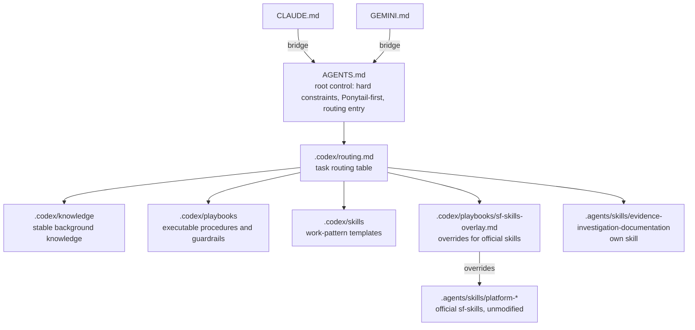

# iotmart-agent-kit

**English** | [繁體中文](README.zh-TW.md)

Coding-agent rules and skills for IoTMart 3.0. Codex, Claude Code and Gemini read the same rules and skills, installed into the project working tree and kept out of the company repository's version control.

## Install for team members (Windows / macOS)

No agent, git skills or admin rights needed.

1. Get the kit: `git clone https://github.com/yoozayang/iotmart-agent-kit.git`, or on the GitHub page click **Code → Download ZIP** and extract it
2. Double-click the installer:
   - Windows: `install-windows.cmd` (if "Windows protected your PC" appears, click **More info → Run anyway**)
   - macOS: right-click `install-mac.command` → **Open** (needed the first time only)
3. When the folder picker appears, choose your IoTMart project folder (the one containing `sfdx-project.json`); **Cancel** installs the skills to your user folder only
4. When "安裝完成" (installation complete) appears, press Enter, then restart Codex / Claude Code / Gemini

What the installer does:
- Copies the rules (`AGENTS.md`, `CLAUDE.md`, `GEMINI.md`, `.codex/`) and skills (`.agents/skills`, `.claude/skills`) into the project and adds them to the project's `.git/info/exclude`
- Copies the Codex execution rules to `~/.codex/rules/iotmart-sf-guard.rules`
- If `.claude/settings.json` already exists, only the kit's ask/deny rules are merged in; existing `.codex/config.toml` and `.gemini/settings.json` are left untouched
- Changed files are first moved to `~/.iotmart-agent-kit-backup/<timestamp>/`; identical files are left alone
- On macOS it asks whether to install the `sf` command guard (`bin/sf`, added to the shell PATH); Windows has no such guard and relies on the Codex rules and Claude permissions

To update: `git pull` (or download the ZIP again) and double-click the installer again. The same steps are in `INSTALL.txt` at the repository root.

The installer's on-screen messages are in Traditional Chinese.

## Architecture



- Precedence: `AGENTS.md` > `.codex/playbooks` > official skills. When rules conflict, the stricter and more conservative one applies
- Official skills only provide knowledge and operating patterns and are never edited by hand; IoTMart-specific constraints live in the overlay

## Directory layout

```text
iotmart-agent-kit/
├── AGENTS.md                  root control layer, read directly by Codex
├── CLAUDE.md                  Claude Code bridge to AGENTS.md and .codex
├── GEMINI.md                  Gemini bridge
├── GIT_GUIDE.md               commit and PR conventions
├── skills-lock.json           skill sources and content hashes
├── .codex/
│   ├── config.toml            Codex MCP settings (Salesforce DX, context7, Notion)
│   ├── rules/sf-guard.rules   Codex execution rules: org-writing commands need confirmation
│   ├── routing.md             task type -> files to read
│   ├── knowledge/             market architecture, system boundaries, SAP/SIS, repo map
│   ├── playbooks/             deploy, prod-validate, uat-compare, mcp-usage, git-baseline, magnolia-flow, sf-skills-overlay
│   └── skills/                requirement-review, minimum-spec, minimum-sdd, test-case-generation, validation-review, deployment-package
├── .agents/skills/            agent skills (own + third party)
├── .claude/settings.json      Claude Code permissions: org-writing commands need confirmation
├── bin/sf, bin/sfdx           sf guard wrapper, execution-layer guard shared by all three agents
├── .gemini/                   Gemini MCP settings and code review style
├── .mcp.json                  Claude Code project MCP settings
├── salesforce-mcp-config.json Salesforce hosted MCP endpoints
├── scripts/link.sh            maintainers: mount into a project with symlinks
├── scripts/install.ps1, install.sh  team members: install by copying
├── scripts/upstream/          risk scan for official skill updates
├── scripts/autoupdate.sh      maintainer's daily local auto-update (kit and personal tools)
├── scripts/install-autoupdate.sh  installs the local schedule
├── personal-tools.json        upstream and update method of personal tools
├── .github/workflows/         upstream-check schedule
├── install-windows.cmd        team member installer entry (Windows, runs scripts/install.ps1)
├── install-mac.command        team member installer entry (macOS, runs scripts/install.sh)
├── INSTALL.txt                install guide for non-technical users
├── THIRD_PARTY_NOTICES.md
└── LICENSES/
```

## Layers

| Layer | Location | Contains | Does not contain |
| --- | --- | --- | --- |
| Root control | `AGENTS.md` | hard constraints, Ponytail-first, routing entry | detailed procedures and file inventories |
| Routing | `.codex/routing.md` | which files to read per task type and layer baseline | rule bodies |
| Knowledge | `.codex/knowledge/*.md` | market architecture, system responsibility boundaries, domain background | operating steps |
| Procedures | `.codex/playbooks/*.md` | deploy, validate, compare, MCP usage and other executable procedures and guardrails | background explanations |
| Work patterns | `.codex/skills/*.md` | output formats for requirement review, minimum spec, SDD, test cases, validation review, deployment package | environment operations |
| Agent skills | `.agents/skills/*/SKILL.md` | own skills and third-party official skills | edits to third-party files |

## Maintainer install (symlink mode)

For people who edit and commit the kit directly; changes show up immediately in mounted projects.

```bash
git clone git@github.com:yoozayang/iotmart-agent-kit.git ~/Development/iotmart-agent-kit
cd ~/Development/iotmart-agent-kit

# project root has no files with the same names
scripts/link.sh ~/Development/IoTMart3.0

# project root already has real AGENTS.md, .codex etc.: move them to ~/codex_tmp/agent-kit-backup/ first, then link
scripts/link.sh ~/Development/IoTMart3.0 --replace

# also expose own skills to other projects (links into ~/.agents/skills/)
scripts/link.sh ~/Development/IoTMart3.0 --user-links
```

`link.sh`:
- creates symlinks in the project root for `AGENTS.md`, `CLAUDE.md`, `GEMINI.md`, `GIT_GUIDE.md`, `skills-lock.json`, `.mcp.json`, `salesforce-mcp-config.json`, `.codex`, `.agents`, `.gemini`, `.claude/settings.json`
- creates `.claude/skills` -> `../.agents/skills` so Claude Code loads the skills natively
- adds those paths to the project's `.git/info/exclude`, so they never show up in the company repo's `git status`
- can be re-run; correctly linked items print `ok`

Execution-layer guard setup (once per machine):

```bash
# 1. Put the bin/sf guard first on PATH in every shell: append to the end of ~/.zprofile and ~/.zshrc
#    (after brew shellenv and other PATH settings), and to ~/.zshenv and ~/.bashrc for non-interactive shells
[ -d "$HOME/Development/iotmart-agent-kit/bin" ] && export PATH="$HOME/Development/iotmart-agent-kit/bin:$PATH"  # iotmart-agent-kit sf guard

# 2. Let Codex load the guard rules
ln -s ~/Development/iotmart-agent-kit/.codex/rules/sf-guard.rules ~/.codex/rules/iotmart-sf-guard.rules
```

Verify:

```bash
cd ~/Development/IoTMart3.0
git status --short                      # no agent files should appear
ls -la AGENTS.md .codex .agents .claude/skills
command -v sf                           # should be ~/Development/iotmart-agent-kit/bin/sf
codex execpolicy check -r ~/.codex/rules/default.rules -r ~/.codex/rules/iotmart-sf-guard.rules -- sf project deploy start   # should be prompt
```

## How each environment reads the kit

| Environment | Rule entry | Skill loading |
| --- | --- | --- |
| Codex | `AGENTS.md` | scans `.agents/skills/` natively |
| Claude Code | `CLAUDE.md` -> `AGENTS.md` | scans `.claude/skills/` natively |
| Gemini | `GEMINI.md` -> `AGENTS.md` | reads `SKILL.md` via the paths in `GEMINI.md` and `routing.md` |

## Skills

### Own
| Skill | Purpose |
| --- | --- |
| `evidence-investigation-documentation` | evidence-led investigation and documentation workflow, including safe Notion update rules |

### Third party
| Skill | Source | Purpose |
| --- | --- | --- |
| `platform-metadata-api-context-get` | forcedotcom/sf-skills | fields, directories, naming and sample XML for 604 Metadata API types |
| `platform-data-and-tooling-api-context-get` | forcedotcom/sf-skills | field definitions for 2130 standard and Tooling objects |
| `platform-metadata-retrieve` | forcedotcom/sf-skills | retrieve command patterns and flags |
| `platform-metadata-deploy` | forcedotcom/sf-skills | deploy/validate reference knowledge; agents must not run deployments on their own |
| `platform-soql-query` | forcedotcom/sf-skills | writing and running SOQL |
| `platform-apex-test-run` | forcedotcom/sf-skills | Apex test execution and coverage |

The official sf-skills were chosen from error statistics of past agent sessions (wrong SOQL fields or objects, non-existent CLI flags, malformed metadata members, etc.); details are on the Notion page "官方Agent Skill整合計畫".

## Optional personal tools

These tools are personal preferences. They are not in this repository and are not installed into projects by `link.sh` or the installers. Install them at user level if wanted (`scripts/autoupdate.sh` and `personal-tools.json` are for the maintainer's own machine):

| Tool | Purpose | Install | Notes |
| --- | --- | --- | --- |
| Ponytail | runs the Ponytail-first evaluation in `AGENTS.md` | Codex personal plugin (git clone at `~/.codex/plugins/ponytail`), updated by `scripts/autoupdate.sh` | optional; the checklist is built into `AGENTS.md` and works without the plugin |
| caveman skills | compressed output, subagent delegation | installed and updated by `scripts/autoupdate.sh` from `personal-tools.json` | `caveman-commit` writes Conventional Commits, which differ from `GIT_GUIDE.md`; `caveman-compress` rewrites the original file; `cavecrew` needs its own subagent definitions |

## Official skills and the overlay

The official skills are written for general use, and parts of them conflict with IoTMart's hard constraints, for example:
- `platform-metadata-deploy` shows `sf project deploy start --source-dir force-app`
- `platform-metadata-retrieve` offers `--ignore-conflicts`
- the default org is used when none is specified

These conflicts are not fixed in the official files. They are written in `.codex/playbooks/sf-skills-overlay.md`; `AGENTS.md` and the Task Routing Table require it before an official Salesforce skill is used. `CLAUDE.md` and `GEMINI.md` bridge to that shared path. When the official skills are upgraded, only the overlay needs to be re-checked.

## Adding or updating skills

Third-party skills:

```bash
cd ~/Development/iotmart-agent-kit
npx skills add <owner>/<repo> -s <skill-name> -a codex -y   # add; writes .agents/skills and skills-lock.json
npx skills update -p -y                                     # update
```

Then:
1. Check the skill against the hard constraints in `AGENTS.md`; write any conflict into the overlay
2. If routing is needed, update `.codex/routing.md`
3. Update `THIRD_PARTY_NOTICES.md` and `LICENSES/`
4. Update the skill list in both READMEs (`README.md`, `README.zh-TW.md`)

Own rules:
- background knowledge goes in `.codex/knowledge/`, executable procedures in `.codex/playbooks/`, output templates in `.codex/skills/`, natively triggered skills in `.agents/skills/<name>/SKILL.md`
- add a Task Routing Table entry only when a new file must be loaded for a distinct task type; do not add static file inventories to `AGENTS.md`

## Upstream updates

Fully automatic, no manual step. Dangerous operations are stopped by the execution-layer guard, not by manually reviewing skill text.

| Target | Runner | Frequency | Action |
| --- | --- | --- | --- |
| official sf-skills (`.agents/skills/platform-*`) | GitHub Actions `upstream-check` | Mondays 09:00 Taipei | opens a PR when upstream changes and merges it automatically; the PR includes a change summary, a risk scan (`scripts/upstream/scan-risk.sh`) and an overlay reference check |
| maintainer's local kit clone | macOS LaunchAgent (`scripts/autoupdate.sh`) | daily 09:30 | `git pull --ff-only`; merged updates take effect in every mounted project |
| personal tools (`personal-tools.json`) | same | daily 09:30 | caveman: reinstalls the listed skills when upstream has a new commit; Ponytail: checks out the newest release tag |

- The only automatic gate: an official skill update may only change `.agents/skills/platform-*`, `skills-lock.json` and `THIRD_PARTY_NOTICES.md`; anything else fails the workflow (GitHub sends an email) and nothing is merged
- Local unpushed changes or modified tool folders are skipped, never overwritten
- A macOS notification appears on update or failure; log: `~/Library/Logs/iotmart-agent-kit-autoupdate.log`
- Roll back Ponytail with the `git -C ~/.codex/plugins/ponytail checkout <old version>` command recorded in the log
- Change which caveman skills are installed by editing `skills` in `personal-tools.json`
- Manual run: `gh workflow run upstream-check.yml`; `bash scripts/autoupdate.sh`
- Install the local schedule: `scripts/install-autoupdate.sh`; remove: `scripts/install-autoupdate.sh --remove`
- The repository must allow GitHub Actions to create pull requests (Settings → Actions → General → Workflow permissions)

## Execution-layer guard

Text rules depend on how well a model follows them, so dangerous operations are also blocked at execution time:

| Layer | Location | Effect | Covers |
| --- | --- | --- | --- |
| `sf` wrapper | `bin/sf` | org-writing commands need an explicit `-o`; Prod allows only `deploy validate`; blocks directory deploys, unscoped deploys and `--ignore-conflicts`; blocks Prod data writes, anonymous Apex and `delete source`; blocks `org delete` | Codex, Claude Code, Gemini, terminal (macOS/Linux) |
| `sfdx` blocker | `bin/sfdx` | always blocked | same |
| Codex rules | `.codex/rules/sf-guard.rules` | org-writing commands prompt; `sfdx`, `sf org delete` and bypass are forbidden; the most restrictive rule wins | Codex |
| Claude permissions | `.claude/settings.json` | org-writing commands ask; `sfdx`, `sf org delete`, bypass and MCP `deploy_metadata` / `delete_org` are denied | Claude Code |
| MCP | `.codex/config.toml`, `.gemini/settings.json` | the Salesforce DX MCP does not enable the `metadata` toolset | Codex, Gemini |

- Prod detection: any org whose `sf org display` instanceUrl is not `*.sandbox.my.salesforce.com` is treated as Prod; orgs that cannot be resolved are blocked
- `SF_GUARD_BYPASS=1 sf ...` is for the user in a terminal only; agent rules explicitly forbid it
- The wrapper is a guardrail, not a security boundary: calling the real `sf` by absolute path bypasses it

## Notes

- This repository holds only agent rules and skills, never `force-app` or any company code
- In a project's `.git/info/exclude`, patterns with a trailing slash (such as `.agents/`) match real directories only, not symlinks; `link.sh` adds the slash-less form
- The Salesforce DX MCP does not enable the `metadata` toolset; retrieve, deploy and validate always go through the `sf` CLI and the playbook authorization flow
- Temporary output always goes to `~/codex_tmp`

## License

Sources and licenses of the third-party skills are listed in [THIRD_PARTY_NOTICES.md](THIRD_PARTY_NOTICES.md).
