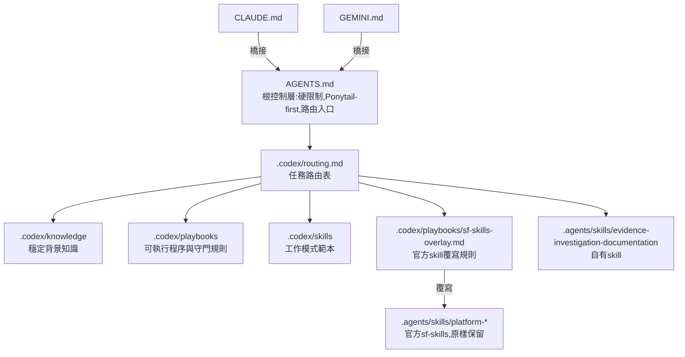

# iotmart-agent-kit

IoTMart 3.0的coding-agent規則與skill集。Codex,Claude Code,Gemini讀同一份規則與skill,以symlink掛進專案工作目錄,不進公司repo版控

## 架構總覽



- 優先序:`AGENTS.md`>`.codex/playbooks`>官方skill。規則衝突時採更嚴格,更保守的一方
- 官方skill只提供知識與操作模式,不手改;IoTMart專屬限制一律寫在overlay

## 目錄結構

```text
iotmart-agent-kit/
├── AGENTS.md                  根控制層,Codex直接讀取
├── CLAUDE.md                  Claude Code橋接,指向AGENTS.md與.codex
├── GEMINI.md                  Gemini橋接
├── GIT_GUIDE.md               Commit與PR規範
├── skills-lock.json           skill來源與內容hash
├── .codex/
│   ├── config.toml            Codex MCP設定(Salesforce DX,context7,Notion)
│   ├── routing.md             任務類型→要讀的檔案
│   ├── knowledge/             市場架構,系統邊界,SAP/SIS,repo地圖
│   ├── playbooks/             deploy,prod-validate,uat-compare,mcp-usage,git-baseline,magnolia-flow,sf-skills-overlay
│   └── skills/                requirement-review,minimum-spec,minimum-sdd,test-case-generation,validation-review,deployment-package
├── .agents/skills/            agent skill(自有+第三方)
├── .gemini/                   Gemini MCP設定與code review風格
├── .mcp.json                  Claude Code專案MCP設定
├── salesforce-mcp-config.json Salesforce hosted MCP端點
├── scripts/link.sh            掛載到專案工作目錄
├── THIRD_PARTY_NOTICES.md
└── LICENSES/
```

## 分層說明

| 層 | 位置 | 放什麼 | 不放什麼 |
| --- | --- | --- | --- |
| 根控制 | `AGENTS.md` | 硬限制,Ponytail-first,路由入口,檔案清單 | 細節流程 |
| 路由 | `.codex/routing.md` | 任務類型對應要讀的檔案,各規則的正式基準位置 | 規則本文 |
| 知識 | `.codex/knowledge/*.md` | 市場架構,系統責任邊界,領域背景 | 操作步驟 |
| 流程 | `.codex/playbooks/*.md` | deploy,validate,比對,MCP使用等可執行程序與守門規則 | 背景說明 |
| 工作模式 | `.codex/skills/*.md` | 需求審查,最小規格,SDD,測試案例,驗證審查,部署包的產出格式 | 環境操作 |
| Agent skill | `.agents/skills/*/SKILL.md` | 自有skill與第三方官方skill | 對第三方檔案的修改 |

## 快速開始

```bash
git clone git@github.com:yoozayang/iotmart-agent-kit.git ~/Development/iotmart-agent-kit
cd ~/Development/iotmart-agent-kit

# 專案根目錄沒有同名檔案時
scripts/link.sh ~/Development/IoTMart3.0

# 專案根目錄已有舊版AGENTS.md,.codex等實體檔案時,先移到~/codex_tmp/agent-kit-backup/再連結
scripts/link.sh ~/Development/IoTMart3.0 --replace

# 讓其他專案也能用自有skill(連結到~/.agents/skills/)
scripts/link.sh ~/Development/IoTMart3.0 --user-links
```

`link.sh`會:
- 在專案根目錄建立`AGENTS.md`,`CLAUDE.md`,`GEMINI.md`,`GIT_GUIDE.md`,`skills-lock.json`,`.mcp.json`,`salesforce-mcp-config.json`,`.codex`,`.agents`,`.gemini`的symlink
- 建立`.claude/skills`→`../.agents/skills`,讓Claude Code原生載入skill
- 在專案的`.git/info/exclude`加入上述路徑,公司repo的`git status`不會出現這些連結
- 可重複執行;已正確連結的項目顯示`ok`

驗證:

```bash
cd ~/Development/IoTMart3.0
git status --short                      # 不應出現agent檔案
ls -la AGENTS.md .codex .agents .claude/skills
```

## 三個環境如何讀取

| 環境 | 規則入口 | Skill載入 |
| --- | --- | --- |
| Codex | `AGENTS.md` | 原生掃描`.agents/skills/` |
| Claude Code | `CLAUDE.md`→`AGENTS.md` | 原生掃描`.claude/skills/`(連到`.agents/skills/`) |
| Gemini | `GEMINI.md`→`AGENTS.md` | 依`GEMINI.md`與`routing.md`的路徑讀取`SKILL.md` |

## Skill清單

### 自有
| Skill | 用途 |
| --- | --- |
| `evidence-investigation-documentation` | 以證據為本的調查與文件化流程,含Notion安全更新規則 |

### 第三方
| Skill | 來源 | 用途 |
| --- | --- | --- |
| `platform-metadata-api-context-get` | forcedotcom/sf-skills | 604種Metadata API型別的欄位,目錄,命名,範例XML |
| `platform-data-and-tooling-api-context-get` | forcedotcom/sf-skills | 2130個標準物件與Tooling物件的欄位定義 |
| `platform-metadata-retrieve` | forcedotcom/sf-skills | retrieve指令模式與flag |
| `platform-metadata-deploy` | forcedotcom/sf-skills | deploy,validate知識參考,agent不可自行執行 |
| `platform-soql-query` | forcedotcom/sf-skills | SOQL寫法與查詢 |
| `platform-apex-test-run` | forcedotcom/sf-skills | Apex測試執行與覆蓋率 |
| `cavecrew`,`caveman*` | JuliusBrussee/caveman | subagent委派與壓縮輸出 |

官方sf-skills的選擇依據是過往agent session的錯誤統計(SOQL欄位或物件寫錯,CLI flag不存在,metadata成員格式錯誤等),細節見Notion「官方Agent Skill整合計畫」頁

## 官方skill與overlay

官方skill為通用情境撰寫,部分內容與IoTMart硬限制衝突,例如:
- `platform-metadata-deploy`示範`sf project deploy start --source-dir force-app`
- `platform-metadata-retrieve`提供`--ignore-conflicts`
- 未指定org時使用預設org

這些衝突不修改官方檔案,而是寫在`.codex/playbooks/sf-skills-overlay.md`,並由`AGENTS.md`,`routing.md`,`CLAUDE.md`,`GEMINI.md`要求使用官方skill前先讀overlay。官方skill升版時只需重新比對overlay一個檔案

## 新增或更新skill

第三方skill:

```bash
cd ~/Development/iotmart-agent-kit
npx skills add <owner>/<repo> -s <skill-name> -a codex -y   # 新增,寫入.agents/skills與skills-lock.json
npx skills update -p -y                                     # 更新
```

之後:
1. 檢查skill內容是否與`AGENTS.md`硬限制衝突,衝突寫進overlay
2. 需要路由時更新`.codex/routing.md`,並在`AGENTS.md`對應清單加入
3. 更新`THIRD_PARTY_NOTICES.md`與`LICENSES/`
4. 更新本README的Skill清單

自有規則:
- 背景知識放`.codex/knowledge/`,可執行程序放`.codex/playbooks/`,產出格式範本放`.codex/skills/`,需原生觸發的skill放`.agents/skills/<name>/SKILL.md`
- 新檔案要同時登記到`.codex/routing.md`與`AGENTS.md`的檔案清單

## 注意事項

- 本repo只放agent規則與skill,不放`force-app`或任何公司程式碼
- 專案`.git/info/exclude`中帶結尾斜線的規則(如`.agents/`)只比對真實目錄,不比對symlink;`link.sh`會補上不帶斜線的版本
- Salesforce DX MCP不啟用`metadata` toolset;retrieve,deploy,validate一律走`sf` CLI並遵守playbook授權流程
- 暫存輸出一律放`~/codex_tmp`

## 授權

第三方skill的來源與授權見[THIRD_PARTY_NOTICES.md](THIRD_PARTY_NOTICES.md)
