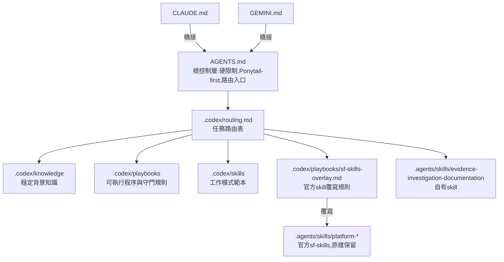

# iotmart-agent-kit

[English](README.md) | **繁體中文**

IoTMart 3.0的coding-agent規則與skill集。Codex,Claude Code,Gemini讀同一份規則與skill,裝進專案工作目錄,不進公司repo版控

## 團隊成員安裝(Windows/macOS)

不需要agent協助,也不需要管理員權限

1. 取得kit:`git clone https://github.com/yoozayang/iotmart-agent-kit.git`,或在GitHub頁面按「Code→Download ZIP」後解壓縮
2. 雙擊安裝檔:
   - Windows:`install-windows.cmd`(若出現「Windows已保護您的電腦」,按「其他資訊」→「仍要執行」)
   - macOS:在`install-mac.command`按右鍵→「打開」(第一次需要,之後可直接雙擊)
3. 跳出「選擇資料夾」時選IoTMart專案資料夾(有`sfdx-project.json`的那一層);按「取消」=只安裝skill到使用者資料夾
4. 看到「安裝完成」後按Enter,重新開啟Codex/Claude Code/Gemini

安裝程式會做的事:
- 把規則(`AGENTS.md`,`CLAUDE.md`,`GEMINI.md`,`.codex/`)與skill(`.agents/skills`,`.claude/skills`)複製進專案,並寫入專案`.git/info/exclude`
- 把Codex執行規則複製到`~/.codex/rules/iotmart-sf-guard.rules`
- `.claude/settings.json`已存在時只合併kit的ask/deny規則;`.codex/config.toml`,`.gemini/settings.json`已存在時保留原檔
- 有變動的舊檔先移到`~/.iotmart-agent-kit-backup/<時間>/`,內容相同則不動
- macOS會詢問是否安裝`sf`指令防護(`bin/sf`,加入shell PATH);Windows沒有此項,由Codex規則與Claude權限把關

更新:`git pull`(或重新下載ZIP)後再雙擊一次安裝檔。操作說明也放在根目錄`INSTALL.txt`

## 架構總覽



- 優先序:`AGENTS.md`>`.codex/playbooks`>官方skill。規則衝突時採更嚴格,更保守的一方
- 官方skill只提供知識與操作模式,不手改;IoTMart專屬限制一律寫在overlay

## 目錄結構

```text
iotmart-agent-kit/
├── AGENTS.md                  根控制層,Codex直接讀取
├── CLAUDE.md                  Claude Code橋接,指向AGENTS.md與.codex
├── GEMINI.md                  Gemini橋接
├── GIT_GUIDE.md               Commit與PR規範
├── skills-lock.json           skill來源與內容hash
├── .codex/
│   ├── config.toml            Codex MCP設定(Salesforce DX,context7,Notion)
│   ├── rules/sf-guard.rules   Codex執行規則:寫入org的指令需確認
│   ├── routing.md             任務類型→要讀的檔案
│   ├── knowledge/             市場架構,系統邊界,SAP/SIS,repo地圖
│   ├── playbooks/             deploy,prod-validate,uat-compare,mcp-usage,git-baseline,magnolia-flow,sf-skills-overlay
│   └── skills/                requirement-review,minimum-spec,minimum-sdd,test-case-generation,validation-review,deployment-package
├── .agents/skills/            agent skill(自有+第三方)
├── .claude/settings.json      Claude Code權限:寫入org的指令需確認
├── bin/sf,bin/sfdx            sf guard wrapper,三個agent共用的執行層防護
├── .gemini/                   Gemini MCP設定與code review風格
├── .mcp.json                  Claude Code專案MCP設定
├── salesforce-mcp-config.json Salesforce hosted MCP端點
├── scripts/link.sh            維護者用:以symlink掛載到專案工作目錄
├── scripts/install.ps1,install.sh 團隊成員用:以複製方式安裝
├── scripts/upstream/          官方skill更新的風險掃描
├── scripts/autoupdate.sh      本機每日自動更新(kit與個人工具)
├── scripts/install-autoupdate.sh 安裝本機排程
├── personal-tools.json        個人工具的上游與更新方式
├── .github/workflows/         upstream-check排程
├── install-windows.cmd        團隊成員安裝入口(Windows,呼叫scripts/install.ps1)
├── install-mac.command        團隊成員安裝入口(macOS,呼叫scripts/install.sh)
├── INSTALL.txt                給非技術使用者的安裝說明
├── THIRD_PARTY_NOTICES.md
└── LICENSES/
```

## 分層說明

| 層 | 位置 | 放什麼 | 不放什麼 |
| --- | --- | --- | --- |
| 根控制 | `AGENTS.md` | 硬限制,Ponytail-first,路由入口 | 細節流程與檔案清單 |
| 路由 | `.codex/routing.md` | 任務類型對應要讀的檔案與分層基準 | 規則本文 |
| 知識 | `.codex/knowledge/*.md` | 市場架構,系統責任邊界,領域背景 | 操作步驟 |
| 流程 | `.codex/playbooks/*.md` | deploy,validate,比對,MCP使用等可執行程序與守門規則 | 背景說明 |
| 工作模式 | `.codex/skills/*.md` | 需求審查,最小規格,SDD,測試案例,驗證審查,部署包的產出格式 | 環境操作 |
| Agent skill | `.agents/skills/*/SKILL.md` | 自有skill與第三方官方skill | 對第三方檔案的修改 |

## 維護者安裝(symlink模式)

直接編輯kit並commit的人使用;改動會即時反映到掛載的專案

```bash
git clone git@github.com:yoozayang/iotmart-agent-kit.git ~/Development/iotmart-agent-kit
cd ~/Development/iotmart-agent-kit

# 專案根目錄沒有同名檔案時
scripts/link.sh ~/Development/IoTMart3.0

# 專案根目錄已有舊版AGENTS.md,.codex等實體檔案時,先移到~/codex_tmp/agent-kit-backup/再連結
scripts/link.sh ~/Development/IoTMart3.0 --replace

# 讓其他專案也能用自有skill(連結到~/.agents/skills/)
scripts/link.sh ~/Development/IoTMart3.0 --user-links
```

`link.sh`會:
- 在專案根目錄建立`AGENTS.md`,`CLAUDE.md`,`GEMINI.md`,`GIT_GUIDE.md`,`skills-lock.json`,`.mcp.json`,`salesforce-mcp-config.json`,`.codex`,`.agents`,`.gemini`,`.claude/settings.json`的symlink
- 建立`.claude/skills`→`../.agents/skills`,讓Claude Code原生載入skill
- 在專案的`.git/info/exclude`加入上述路徑,公司repo的`git status`不會出現這些連結
- 可重複執行;已正確連結的項目顯示`ok`

執行層防護設定(每台機器一次):

```bash
# 1. 讓所有shell優先使用bin/sf guard;加在~/.zprofile與~/.zshrc最後一行(在brew shellenv等PATH設定之後),
#    並加入~/.zshenv與~/.bashrc以涵蓋非互動shell
[ -d "$HOME/Development/iotmart-agent-kit/bin" ] && export PATH="$HOME/Development/iotmart-agent-kit/bin:$PATH"  # iotmart-agent-kit sf guard

# 2. 讓Codex載入guard規則
ln -s ~/Development/iotmart-agent-kit/.codex/rules/sf-guard.rules ~/.codex/rules/iotmart-sf-guard.rules
```

驗證:

```bash
cd ~/Development/IoTMart3.0
git status --short                      # 不應出現agent檔案
ls -la AGENTS.md .codex .agents .claude/skills
command -v sf                           # 應為~/Development/iotmart-agent-kit/bin/sf
codex execpolicy check -r ~/.codex/rules/default.rules -r ~/.codex/rules/iotmart-sf-guard.rules -- sf project deploy start   # 應為prompt
```

## 三個環境如何讀取

| 環境 | 規則入口 | Skill載入 |
| --- | --- | --- |
| Codex | `AGENTS.md` | 原生掃描`.agents/skills/` |
| Claude Code | `CLAUDE.md`→`AGENTS.md` | 原生掃描`.claude/skills/`(連到`.agents/skills/`) |
| Gemini | `GEMINI.md`→`AGENTS.md` | 依`GEMINI.md`與`routing.md`的路徑讀取`SKILL.md` |

## Skill清單

### 自有
| Skill | 用途 |
| --- | --- |
| `evidence-investigation-documentation` | 以證據為本的調查與文件化流程,含Notion安全更新規則 |

### 第三方
| Skill | 來源 | 用途 |
| --- | --- | --- |
| `platform-metadata-api-context-get` | forcedotcom/sf-skills | 604種Metadata API型別的欄位,目錄,命名,範例XML |
| `platform-data-and-tooling-api-context-get` | forcedotcom/sf-skills | 2130個標準物件與Tooling物件的欄位定義 |
| `platform-metadata-retrieve` | forcedotcom/sf-skills | retrieve指令模式與flag |
| `platform-metadata-deploy` | forcedotcom/sf-skills | deploy,validate知識參考,agent不可自行執行 |
| `platform-soql-query` | forcedotcom/sf-skills | SOQL寫法與查詢 |
| `platform-apex-test-run` | forcedotcom/sf-skills | Apex測試執行與覆蓋率 |

官方sf-skills的選擇依據是過往agent session的錯誤統計(SOQL欄位或物件寫錯,CLI flag不存在,metadata成員格式錯誤等),細節見Notion「官方Agent Skill整合計畫」頁

## 可選的個人工具

下列工具屬個人工作偏好,不放在本repo,也不會由`link.sh`或安裝程式裝進專案。需要時自行安裝在使用者層級(`scripts/autoupdate.sh`與`personal-tools.json`為維護者本機使用):

| 工具 | 用途 | 安裝 | 注意 |
| --- | --- | --- | --- |
| Ponytail | 執行`AGENTS.md`的Ponytail-first評估 | Codex personal plugin(git clone於`~/.codex/plugins/ponytail`),由`scripts/autoupdate.sh`更新 | 可選;評估清單已內建於`AGENTS.md`,沒有plugin也能照清單執行 |
| caveman系列 | 壓縮輸出,subagent委派 | 由`scripts/autoupdate.sh`依`personal-tools.json`安裝與更新 | `caveman-commit`產出Conventional Commits,與`GIT_GUIDE.md`格式不同;`caveman-compress`會覆寫原檔;`cavecrew`需另備subagent定義 |

## 官方skill與overlay

官方skill為通用情境撰寫,部分內容與IoTMart硬限制衝突,例如:
- `platform-metadata-deploy`示範`sf project deploy start --source-dir force-app`
- `platform-metadata-retrieve`提供`--ignore-conflicts`
- 未指定org時使用預設org

這些衝突不修改官方檔案,而是寫在`.codex/playbooks/sf-skills-overlay.md`;`AGENTS.md`與Task Routing Table要求使用官方Salesforce skill前先讀overlay,`CLAUDE.md`與`GEMINI.md`只橋接到這條共用路徑。官方skill升版時只需重新比對overlay一個檔案

## 新增或更新skill

第三方skill:

```bash
cd ~/Development/iotmart-agent-kit
npx skills add <owner>/<repo> -s <skill-name> -a codex -y   # 新增,寫入.agents/skills與skills-lock.json
npx skills update -p -y                                     # 更新
```

之後:
1. 檢查skill內容是否與`AGENTS.md`硬限制衝突,衝突寫進overlay
2. 需要路由時更新`.codex/routing.md`
3. 更新`THIRD_PARTY_NOTICES.md`與`LICENSES/`
4. 更新`README.md`與`README.zh-TW.md`的Skill清單

自有規則:
- 背景知識放`.codex/knowledge/`,可執行程序放`.codex/playbooks/`,產出格式範本放`.codex/skills/`,需原生觸發的skill放`.agents/skills/<name>/SKILL.md`
- 只有新檔案需由特定任務類型載入時才新增Task Routing Table項目,不可在`AGENTS.md`新增靜態檔案清單

## 上游更新機制

全自動,不需人工介入;危險操作由執行層防護攔截,不依賴人工審查skill內容

| 對象 | 執行者 | 頻率 | 動作 |
| --- | --- | --- | --- |
| 官方sf-skills(`.agents/skills/platform-*`) | GitHub Actions `upstream-check` | 每週一09:00(台北) | 有更新時建立PR並自動合併;PR附變更摘要,風險掃描(`scripts/upstream/scan-risk.sh`)與overlay引用檢查 |
| 本機kit clone | macOS LaunchAgent(`scripts/autoupdate.sh`) | 每日09:30 | `git pull --ff-only`,合併後的更新自動生效於所有掛載專案 |
| 個人工具(`personal-tools.json`) | 同上 | 每日09:30 | caveman:上游有新commit時重新安裝列出的skill;Ponytail:切換到最新release tag |

- 唯一的自動閘門:官方skill更新只能改動`.agents/skills/platform-*`,`skills-lock.json`,`THIRD_PARTY_NOTICES.md`;超出範圍時workflow失敗(GitHub寄信通知),不合併
- 本機有未推送修改或工具目錄有修改時略過該項,不覆蓋
- 有更新或失敗時跳出macOS通知;紀錄:`~/Library/Logs/iotmart-agent-kit-autoupdate.log`
- 回復Ponytail舊版:log中記有`git -C ~/.codex/plugins/ponytail checkout <舊版>`
- 調整caveman安裝範圍:編輯`personal-tools.json`的`skills`
- 手動觸發:`gh workflow run upstream-check.yml`;`bash scripts/autoupdate.sh`
- 安裝本機排程:`scripts/install-autoupdate.sh`;移除:`scripts/install-autoupdate.sh --remove`
- Repo設定需允許GitHub Actions建立PR(Settings→Actions→General→Workflow permissions)

## 執行層防護

文字規則依模型遵循程度而定,因此對危險操作另加執行層防護:

| 層 | 位置 | 作用 | 涵蓋 |
| --- | --- | --- | --- |
| `sf` wrapper | `bin/sf` | 寫入org的指令必須明確`-o`;Prod只允許`deploy validate`;禁止目錄部署,無範圍部署,`--ignore-conflicts`;Prod禁止資料寫入,匿名Apex,`delete source`;禁止`org delete` | Codex,Claude Code,Gemini,終端機 |
| `sfdx` blocker | `bin/sfdx` | 一律阻擋 | 同上 |
| Codex rules | `.codex/rules/sf-guard.rules` | 寫入org的指令prompt;`sfdx`,`sf org delete`,bypass為forbidden;最嚴格者優先 | Codex |
| Claude permissions | `.claude/settings.json` | 寫入org的指令ask;`sfdx`,`sf org delete`,bypass,MCP `deploy_metadata`,`delete_org`為deny | Claude Code |
| MCP | `.codex/config.toml`,`.gemini/settings.json` | Salesforce DX MCP不啟用`metadata` toolset | Codex,Gemini |

- 判定Prod的方式:`sf org display`的instanceUrl不是`*.sandbox.my.salesforce.com`即視為Prod;無法解析的org一律阻擋
- `SF_GUARD_BYPASS=1 sf ...`僅供使用者本人在終端機使用,agent規則明確禁止
- wrapper是護欄不是安全邊界:以真實`sf`絕對路徑呼叫可繞過

## 注意事項

- 本repo只放agent規則與skill,不放`force-app`或任何公司程式碼
- 專案`.git/info/exclude`中帶結尾斜線的規則(如`.agents/`)只比對真實目錄,不比對symlink;`link.sh`會補上不帶斜線的版本
- Salesforce DX MCP不啟用`metadata` toolset;retrieve,deploy,validate一律走`sf` CLI並遵守playbook授權流程
- 暫存輸出一律放`~/codex_tmp`

## 授權

第三方skill的來源與授權見[THIRD_PARTY_NOTICES.md](THIRD_PARTY_NOTICES.md)
